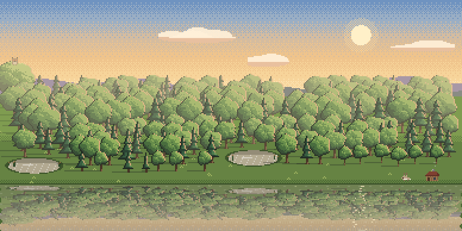

# APNG test for Commit Forest

Does GitHub play animated PNGs in a README? Each image below is a 4-second loop (it has no loop mode yet, so it jumps every 4 s; that is expected).

## 1. Relative path, animated PNG

## 2. Absolute raw URL, animated PNG (goes through GitHub's image proxy, like a profile README pointing at an output branch)

## 3. Inside `<picture>`, dark and light (how the Action would be used)

<picture>
  <source media="(prefers-color-scheme: dark)" srcset="https://raw.githubusercontent.com/baraklevy20/commit-forest-apng-test/main/img/aurora.apng.png">
  
</picture>

## 4. GIF, for comparison

